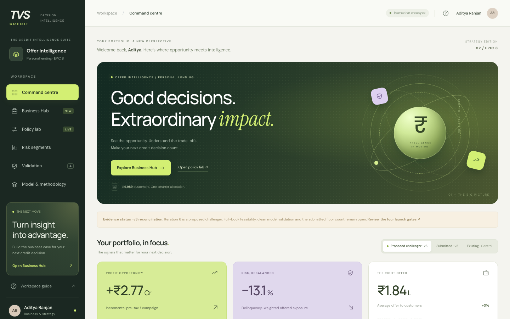
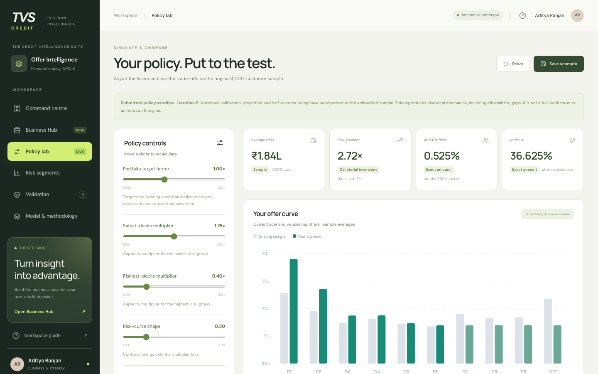

# TVS Credit · Offer Intelligence

**Personal-loan offer amount optimisation: an interactive credit-policy prototype.**

Built for TVS Credit's **EPIC 8 Business Analytics** case (Case 2: Personal Loan Offer Amount Optimisation) by Aditya Ranjan, Indian School of Business.

### 🔗 Live prototype: **[tvscreditadityaisb.vercel.app](https://tvscreditadityaisb.vercel.app)**



---

## The problem

TVS Credit pre-approves personal-loan offer amounts for its existing customers. Under the current policy, offer size barely tracks risk. The safest risk decile gets only **1.08×** the offer of the riskiest, with **3 material inversions** where a riskier decile is offered more than a safer one.

The case asks for a policy that gives more credit to safer customers and less to riskier ones, while respecting:

- affordability (FOIR) caps per customer
- the **₹40,000 – ₹6,00,000** offer range on a **₹10,000** grid
- a portfolio-level average close to today's (₹1,78,155 on TEST)

Working base: **157,556 customers** (TEST 119,989 / VALIDATION 37,567). Risk is ranked on **21,687 disbursed TEST borrowers** with 481 composite 30+ DPD events.

## The answer in one screen

| | Existing policy | Proposed challenger (Iteration 6) |
|---|---|---|
| Safest ÷ riskiest offer (gradient) | 1.08× | **2.51×** (design target) |
| Material inversions | 3 | **0** (target) |
| Modelled pre-tax profit, one campaign | ₹19.00 Cr | **₹21.77 Cr** (+₹2.77 Cr, +14.6%) |
| Return on equity | 21.4% | **23.8%** |
| Offered exposure | – | +3.0% |
| Delinquency-weighted offered exposure | – | **−13.1%** (target) |

Profit figures are modelled base-scenario estimates, not observed results. See [Evidence & caveats](#evidence--caveats).

## What's in the prototype

The workspace has six pages. Each one is a hash route, so you can link to it directly.

| Page | What you can do |
|---|---|
| **[Command centre](https://tvscreditadityaisb.vercel.app/#overview)** | Headline KPIs and the offer curve by risk decile. Switch between *Existing*, *Submitted (Iteration 5)* and *Proposed challenger (Iteration 6)*. |
| **[Business Hub](https://tvscreditadityaisb.vercel.app/#business)** | Profit bridge (₹19.00 Cr → ₹21.77 Cr), disbursal, expected credit loss and ROE. Includes a 50/50 **pilot sizing planner** with conservative and optimistic scenarios and a draw-down stress test (break-even needs about 31% of the extra offer drawn). Exports an **executive brief** as Markdown. |
| **[Policy lab](https://tvscreditadityaisb.vercel.app/#policy)** | Six sliders re-run the submitted policy live on an embedded **4,000-customer sample**: portfolio target factor, safest- and riskiest-decile multipliers, risk-curve shape, stored-cap scale and maximum offer. Shows average offer, risk gradient, ₹40k and ₹50k floor shares, inversions and cap breaches. You can save up to 5 scenarios in the browser and export them. |
| **[Risk segments](https://tvscreditadityaisb.vercel.app/#segments)** | Decile-by-decile view (D1 safest → D10 riskiest) of existing offer, selected offer, change and observed 30+ DPD. |
| **[Validation](https://tvscreditadityaisb.vercel.app/#validation)** | Observed outcomes by offer bucket with Wilson 95% intervals, the open floor-count reconciliation, the **controlled pilot design**, and the four launch gates. |
| **[Model & methodology](https://tvscreditadityaisb.vercel.app/#methodology)** | The three-model pipeline, a comparison of all seven policy iterations, and the Iteration 6 design. |



## Approach

**Three models:**

| | Model | Result | Caveat stated in the app |
|---|---|---|---|
| A | Replicate existing offers | R² 0.786, MAE ₹30,478 on a 25% TEST hold-out | Explains incumbent offers; does not judge a new policy. |
| B | Rank credit risk (WOE scorecard) | AUC 0.6601 · Gini 0.3201 · KS 0.2394 | WOE/IV were fitted before the split, so these scores are optimistic. Scores need calibration. |
| C | Estimate capacity (LightGBM) | R² 0.991 on the 86.2% clean-payer subset | Fits an engineered target, not observed repayment. |

**Seven policy iterations:**

| # | Iteration | Gradient | Material inversions | Mean offer |
|---|---|---|---|---|
| 0 | Control (existing) | 1.08× | 3 | ₹1,78,155 |
| 1 | Learned segment table | 1.29× | 3 | ₹1,93,286 |
| 2 | Isotonic on PD | 1.94× | 3 | ₹1,78,787 |
| 3 | Monotone GBM | 1.31× | 4 | ₹1,87,492 |
| 4 | Constrained optimisation | 1.87× | 3 | ₹1,89,203 |
| 5 | + monotone projection *(submitted)* | 2.50× | 0 | ₹1,88,254 |
| 6 | Budget-based challenger *(proposed)* | 2.51× (target) | 0 (target) | ₹1,83,500 (target) |

**Iteration 6 design:**

1. **Risk:** smooth the observed decile event rates, `ln(rate) = −4.97236 + 0.170607 × decile`.
2. **Budget:** set each decile's budget proportional to `smoothed rate^−0.6`. Budgets fall about 9.7% per decile.
3. **Capacity:** share each decile's budget by `capacity^0.25`, within affordability caps, the ₹40k–₹6L bounds and the ₹10k grid.
4. **Feasibility:** prove the targets can be met on the full book. This step is still pending.

## Evidence & caveats

Every number in the app carries an evidence label: `OBSERVED`, `DERIVED`, `MODEL`, `SAMPLE`, `SCENARIO`, `DESIGN`, `POLICY`, `EXTERNAL` or `PENDING`. The labels come from an 89-claim audit reconciled to the v3 claim register, deck and notebook. Open questions are shown in the app, not hidden.

**Launch gates (all pending):**

1. **Clean risk validation:** refit WOE and feature selection on training rows only, test on an untouched hold-out, and calibrate.
2. **Full-book policy confirmation:** run Iteration 6 on all 157,556 customers and reconcile the ₹40k vs ₹50k floor counts.
3. **Affordability repair:** apply the cap last, round down, and show zero cap breaches.
4. **Fairness & conduct:** review impact across age, gender, geography and employment. Approve explanations for customers who receive lower offers.

**Proposed pilot:** randomise 50/50 between incumbent and challenger within each risk decile, with reviews at day 30, month 3 and month 6. Stop on any affordability breach, or if challenger delinquency in deciles 8–10 exceeds the agreed margin.

## Data

The page embeds only aggregates and an anonymised sample:

- decile-level offer and risk curves, iteration metrics and population counts
- the audited claim register snapshot (`version 2026-10-06-v3-audited`)
- a **4,000-row TEST sample** with stored cap, PD decile, FOIR, existing offer, take-up flag and risk flag. It has no names or IDs.

The raw 157,556-row case dataset, the financial model workbook and the notebook are **not** in this repo.

## Tech

- One self-contained **`index.html`** (~287 KB): vanilla JavaScript, inline CSS and hand-built SVG charts
- No framework, no build step and no backend. The only external request is Google Fonts.
- Hash-based routing (`#overview`, `#business`, `#policy`, …)
- Saved scenarios and the pilot plan are kept in `localStorage` (`tvs-policy-scenarios-v3`, `tvs-business-plan`)

### Run locally

```bash
open index.html
```

Or serve the folder:

```bash
npx serve .
```

## Deployment

This repo is connected to the Vercel project **`tvscreditadityaisb`**. Every push to `main` deploys to production at [tvscreditadityaisb.vercel.app](https://tvscreditadityaisb.vercel.app).

`vercel.json` turns on clean URLs. It also redirects the old file paths (`/offer-intelligence-standalone`, `/tvs_credit_aditya_isb`) to `/`, so links you shared earlier still work.

```
.
├── index.html          # the whole prototype
├── vercel.json         # clean URLs + legacy redirects
└── docs/screenshots/   # images used in this README
```

## Disclaimer

This is a research prototype for a case competition. It makes no live customer decisions and is not an official TVS Credit product. Financial results are scenario estimates. Sample-based figures are labelled as such.
